# 🌿 Naturens Helt

Et 3D-spill i nettleseren (HTML, CSS og JavaScript med [Three.js](https://threejs.org) via CDN).
Velg mellom tre megastore verdener – nordlig villmark, tropisk villmark og savanne og fjell – hjelp dyr og mennesker, og stopp alle krypskytterne. Ingen blod: krypskyttere overgir seg og blir arrestert, og dyr blir bare skremt bort.

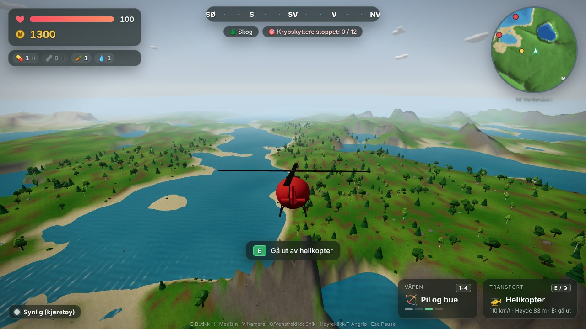

## Bilder fra spillet

### Bane 1 · Nordlig villmark

| | |
| --- | --- |
| 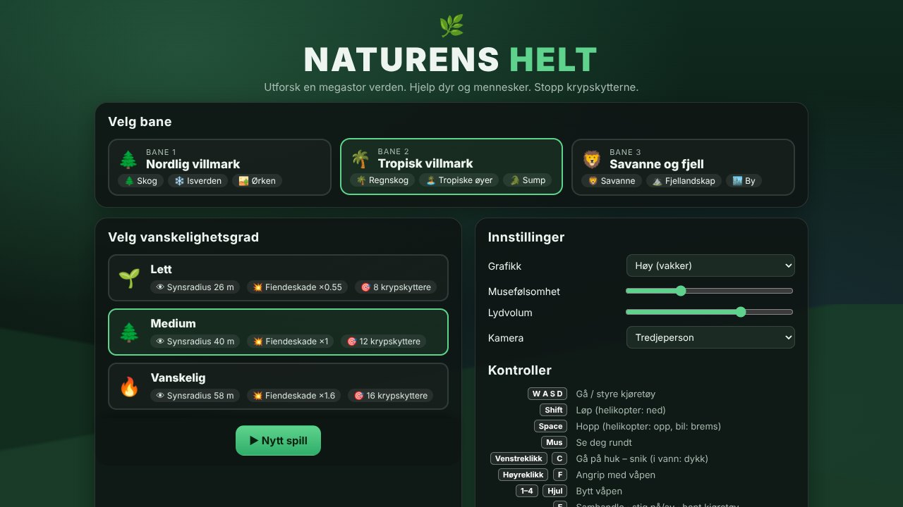 | 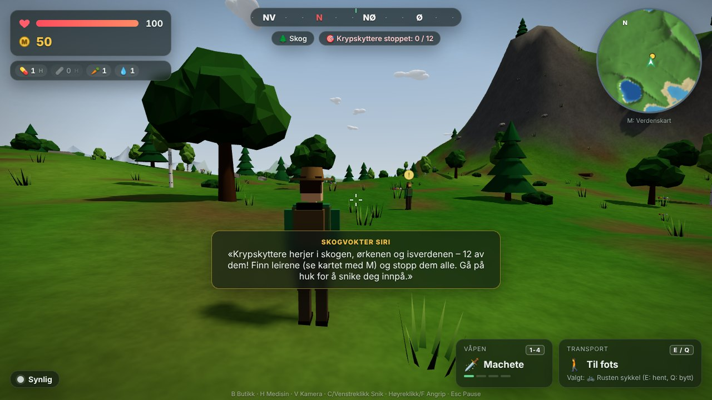 |
| **Hovedmeny** – velg bane og vanskelighetsgrad (Lett, Medium eller Vanskelig). | **Start i skogen** – skogvokter Siri gir det første oppdraget. |
| 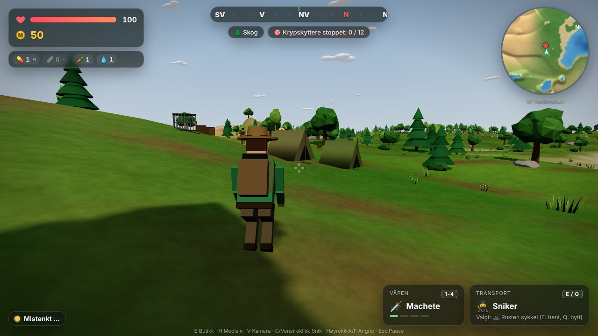 | 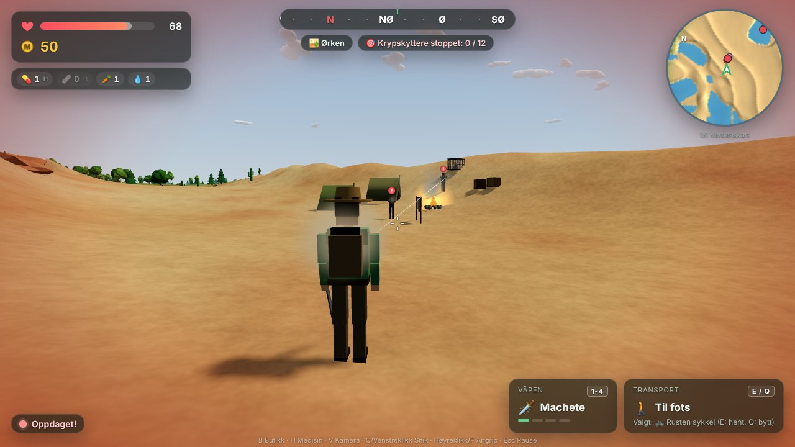 |
| **Snik** – på huk mot en leir. «?» betyr at krypskytteren er mistenksom. | **Ørken** – krypskytterne har oppdaget deg («!») og skyter. |
| 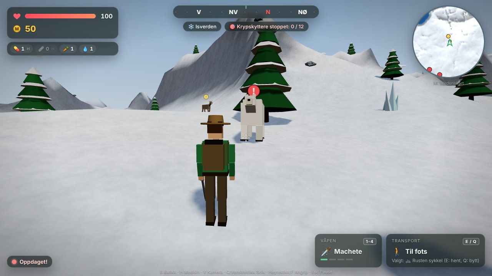 | 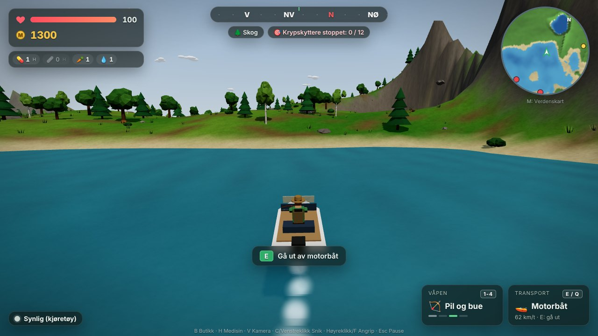 |
| **Isverden** – isbjørn og et sultent reinsdyr. | **Båt** – kryss innsjøer trygt for haiene. |
| 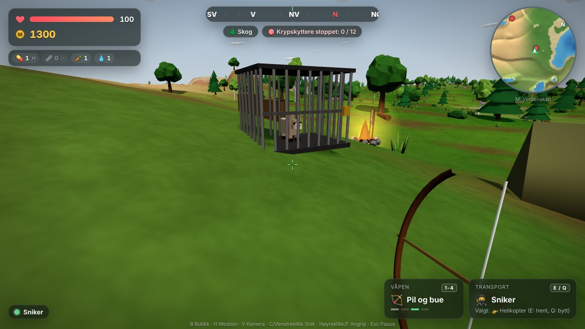 | 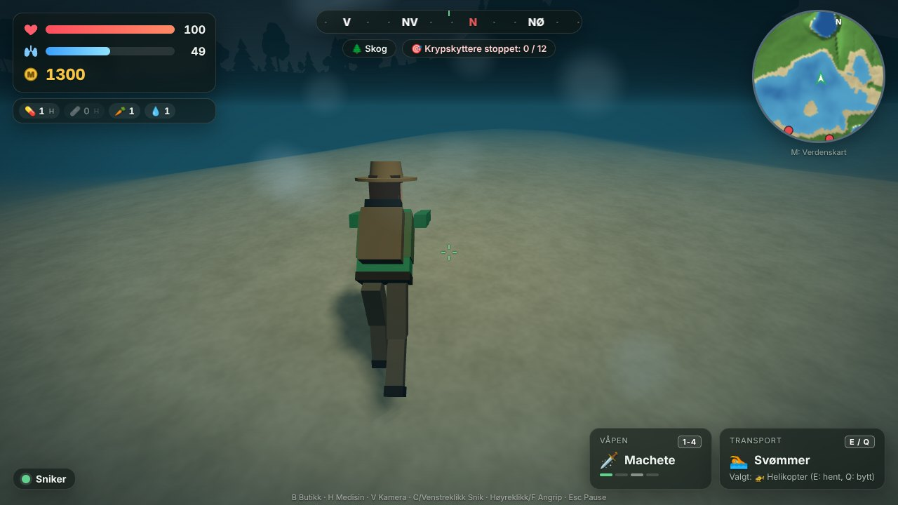 |
| **Førsteperson** – befri dyr som krypskytterne har fanget. | **Under vann** – følg med på pustemåleren. |
| 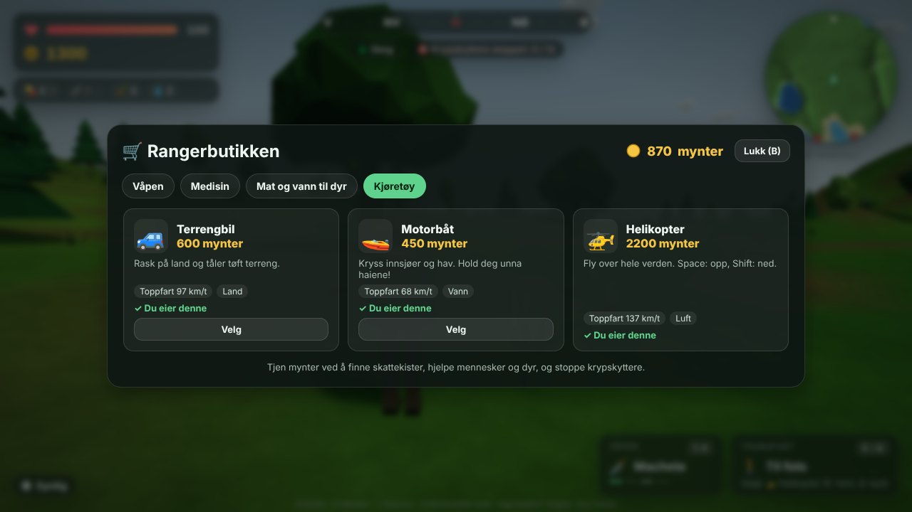 | 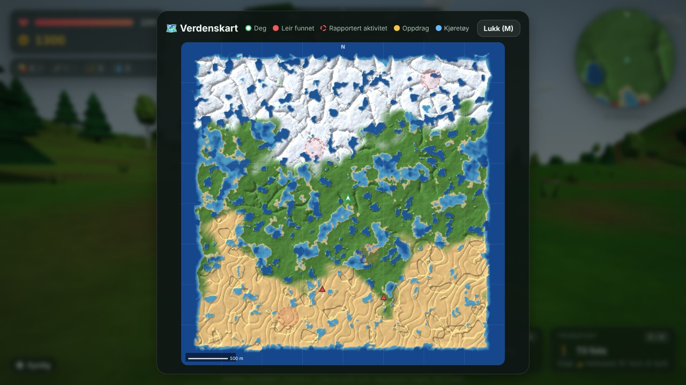 |
| **Butikken (B)** – våpen, medisin, dyrefôr og kjøretøy. | **Verdenskart (M)** – leirer og rapportert aktivitet. |

### Bane 2 · Tropisk villmark

| | |
| --- | --- |
| 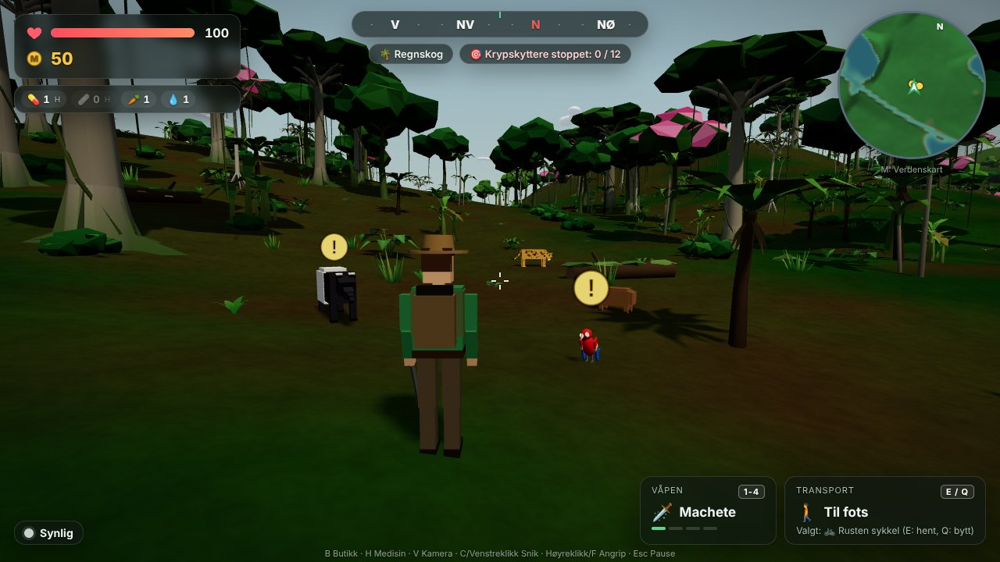 | 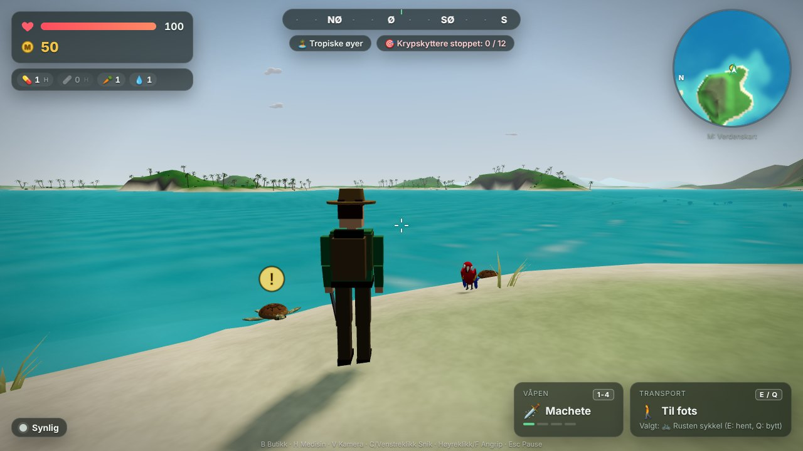 |
| **Regnskog** – tapir, papegøye og kapybara trenger hjelp, og en jaguar lusker i bakgrunnen. | **Tropiske øyer** – turkist vann, palmestrender og havskilpadder. |
| 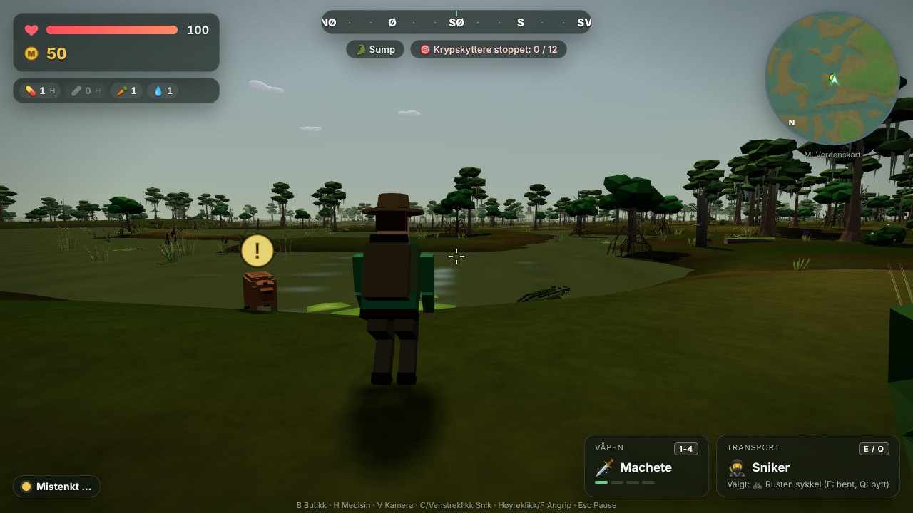 | |
| **Sump** – krokodillene lurer i vannet og kan også gå på land. | |

### Bane 3 · Savanne og fjell

| | |
| --- | --- |
| 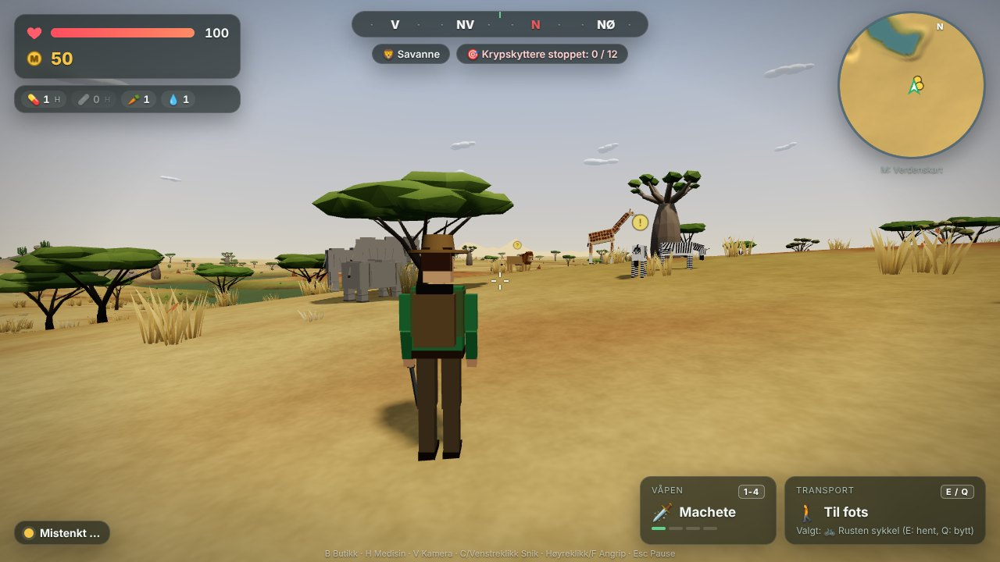 | 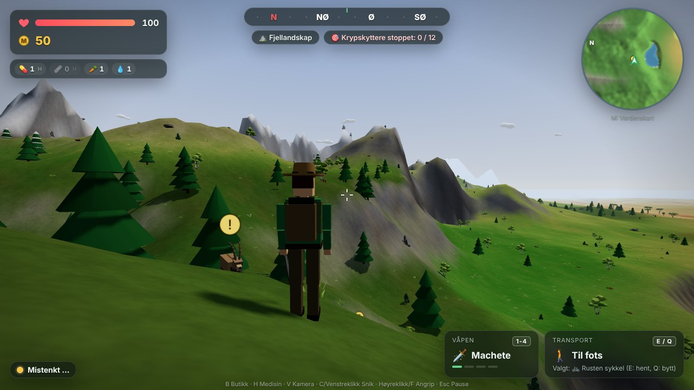 |
| **Savanne** – elefanter, sjiraff, sebraer og neshorn – og løver som jakter. | **Fjellandskap** – steinbukker, snøleoparder og snødekte topper. |
| 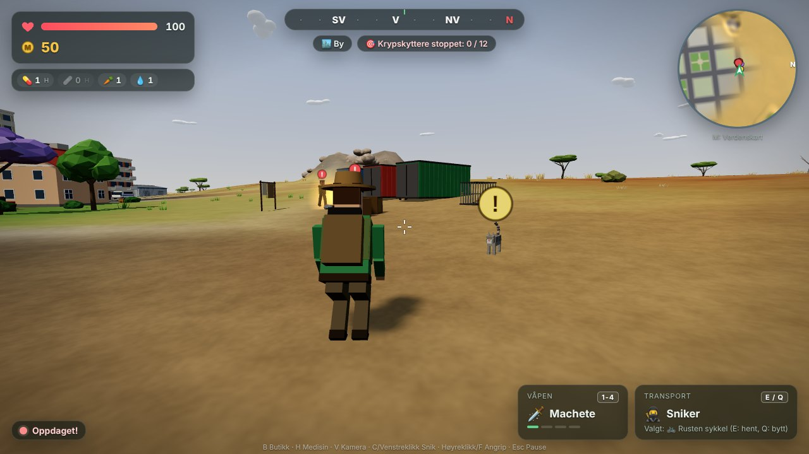 | 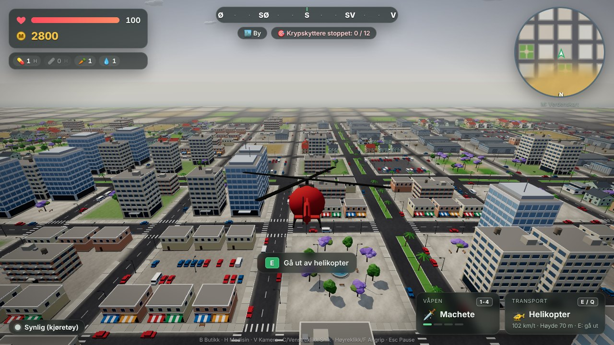 |
| **By** – smuglerne gjemmer fangede dyr i skipscontainere. | **Helikopter over byen** – du kan også lande på hustakene. |

## Slik starter du spillet

Spillet bruker JavaScript-moduler, så det må serveres fra en webserver (ikke åpnes direkte som fil):

```bash
python3 -m http.server 8000
# eller
npx serve .
```

Åpne så <http://localhost:8000>. Spillet kan også publiseres gratis med GitHub Pages (Settings → Pages → «Deploy from a branch»).

## Kontroller

| Tast | Handling |
| --- | --- |
| W A S D | Gå / styre kjøretøy |
| Shift | Løp (helikopter: ned) |
| Space | Hopp (helikopter: opp, bil: brems) |
| Mus | Se deg rundt (PointerLock) |
| Venstreklikk / C | Gå på huk – snik (i vann: dykk) |
| Høyreklikk / F | Angrip |
| 1–4 / musehjul | Bytt våpen |
| E | Samhandle · stig på/av · hent valgt kjøretøy |
| Q | Velg kjøretøy |
| H | Bruk medisin |
| B | Butikk |
| M | Verdenskart |
| V | Bytt mellom 1. og 3. person |
| Esc | Pause |

### Mobil og nettbrett

Spillet kan spilles med berøring på telefon og nettbrett (oppdages automatisk; `?touch` i adressen tvinger berøringsmodus).
Hold telefonen liggende. Grafikk står på «Lav» som standard på mobil.

| Berøring | Handling |
| --- | --- |
| Venstre tommel | Styrespak: gå / styre kjøretøy (helt ut = løp) |
| Høyre tommel | Dra for å se deg rundt |
| ⚔️ · ⤒ · 🏃 · 🥷 | Angrip · hopp (helikopter: opp, bil: brems) · løp (helikopter: ned) · snik |
| ✋ · 🔁 | Samhandle / stig på og av (lyser når noe er i nærheten) · bytt våpen |
| ⏸ 🗺️ 🛒 💊 🚲 🎥 | Pause · kart · butikk · medisin · velg kjøretøy · kamera |

På Android går spillet i fullskjerm når du starter. På iPhone får du fullskjerm ved å velge «Del → Legg til på Hjem-skjerm» og starte spillet derfra.

## Baner

Velg fritt mellom tre baner i startmenyen. Hver bane er en egen 4 × 4 km verden med tre biomer fra nord til sør, egne dyr og egne krypskytterleirer:

| Bane | Biomer | Farlige dyr | Dyr som trenger hjelp |
| --- | --- | --- | --- |
| 🌲 **1 · Nordlig villmark** | Skog, isverden, ørken | Bjørn, isbjørn, ulv, kjempeskorpion, hai | Hjort, rev, hare, reinsdyr, pingvin, kamel, ørkenrev |
| 🌴 **2 · Tropisk villmark** | Regnskog, tropiske øyer, sump | Jaguar, villsvin, krokodille, hai | Tapir, kapybara, papegøye, havskilpadde |
| 🦁 **3 · Savanne og fjell** | Afrikansk savanne, fjellandskap, by | Løve, hyene, snøleopard, ulv, bjørn, vakthund, krokodille | Elefant, sjiraff, sebra, neshorn, steinbukk, katt |

I byen gjemmer smuglerne fangede dyr i skipscontainere, og husene blokkerer sikten – perfekt for å snike seg innpå. Helikopteret kan lande på hustakene.

## Innhold

- **Verden:** Prosedyrisk generert terreng med tre biomer per bane, innsjøer og hav rundt. Terrenget strømmes inn i biter med detaljnivå etter avstand, og tåke, vannfarge og lyd endrer seg mykt mellom biomene.
- **Skatter:** Skattekister er gjemt ved trær og steiner, på fjelltopper og på bunnen av innsjøer.
- **Snik:** Gå på huk for å senke kameraet, bevege deg saktere og bli mye vanskeligere å oppdage – særlig i busker. Snikangrep med macheten får en krypskytter til å overgi seg med én gang.
- **Fiender:** Krypskyttere og rovdyr (bjørn, ulv, hai, jaguar, krokodille, løve, snøleopard m.fl.) vet ikke hvor du er. De har synsradius, synsfelt og hørsel, og angriper først når de oppdager deg. Hus, trær og steiner blokkerer sikten.
- **Helse og pust:** 100 helse. Du kan bli skutt, angrepet av dyr eller drukne hvis du er for lenge i vannet uten båt.
- **Økonomi:** Tjen mynter på skatter, side-oppdrag (mistede sekker, sultne/tørste dyr, skadde klatrere, dyr i bur) og arrestasjoner. Kjøp våpen, medisin, dyremat/vann og kjøretøy i butikken (B).
- **Kjøretøy:** Rusten sykkel (start), terrengbil, motorbåt og helikopter.
- **Vanskelighetsgrad:** Lett, Medium og Vanskelig påvirker fiendenes skade, synsradius og antall krypskyttere.
- **Seier:** Stopp alle krypskytterne. Verdenskartet (M) viser områder der det er rapportert krypskytteraktivitet.
- **Lagring:** Spillet lagres automatisk i nettleseren og kan fortsettes fra hovedmenyen (knappen viser hvilken bane som er lagret).

## Utvikling

Spillet trenger ingen bygging. Utviklerverktøyene krever Node 22:

```bash
npm install          # ESLint, Three.js og Playwright (bare for testing)
npm test             # lint + raske kontroller av verden, modeller, dyr og leirer (sekunder)
npm run smoke        # starter alle baner i en headless nettleser
npm run touch        # tester berøringskontrollene på en liggende telefon
npm start            # spillet på http://localhost:8000
```

GitHub Actions kjører de samme kontrollene på hver pull request. Se `CLAUDE.md` for arbeidsregler og flere verktøy.

## Kodestruktur

```
index.html          HUD og menyer
css/style.css       Stil
js/main.js          Spill-løkke og tilstander
js/config.js        Balansering: vanskelighetsgrad, våpen, kjøretøy, butikk
js/levels/          Baner, biomer (én modul per biom + 3D-modeller) og artsregister – se js/levels/README.md
js/world/           Terrenggenerering, biter (chunks), vegetasjon, himmel/vann, leirer
js/models/          Prosedyriske 3D-modeller (trær, figurer, kjøretøy, gjenstander)
js/entities/        Spiller, kjøretøy, krypskyttere, dyr, mennesker, AI
js/systems/         Kamp, partikler, oppdrag
js/ui/              HUD, minikart/verdenskart, menyer og butikk
js/core/            Input, lyd (Web Audio) og lagring
tools/              Utviklerverktøy: webserver, kontroller (check.mjs) og nettleserscenarier (run.mjs + scenarios/)
```
